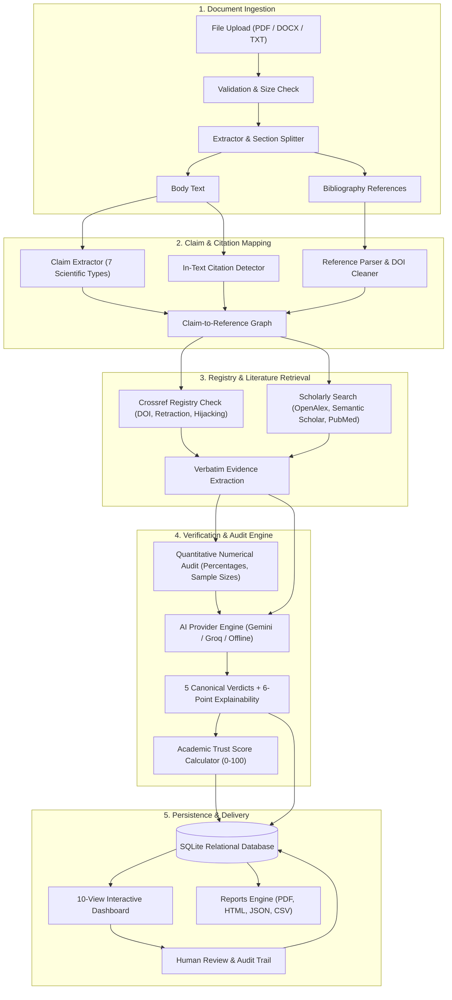

# 🔎 CiteVerify — Scientific Claim & Citation Verification Platform

[](https://citeverify-h7lq.onrender.com)
[](https://github.com/maheshgowdanmg-del/CiteVerify)
[](https://www.python.org/)
[](tests/)
[](LICENSE)

> **Central Axiom:** *A citation is not proof by itself.*  
> Confirming that a publication exists in a scholarly index only proves that a title was registered. CiteVerify answers the real academic integrity question: **Does the cited peer-reviewed source genuinely support the specific scientific assertion and quantitative measurements claimed in the text?**

---

## 🌐 Production & Local Endpoints

| Resource | URL | Status | Purpose |
| :--- | :--- | :--- | :--- |
| **Production Cloud App** | [https://citeverify-h7lq.onrender.com](https://citeverify-h7lq.onrender.com) | 🟢 Live | Web-accessible deployment on Render Cloud |
| **GitHub Repository** | [https://github.com/maheshgowdanmg-del/CiteVerify](https://github.com/maheshgowdanmg-del/CiteVerify) | 🟢 Main | Source code, test suites & CI/CD assets |
| **Local Development** | `http://localhost:8501` | 🟢 Local | High-performance local Streamlit server |

---

## 📌 Executive Summary & Hackathon Problem Statement

Modern scientific publishing and automated AI literature synthesis face an unprecedented research integrity crisis:
1. **Citation Hallucination & Fabrication**: Large language models and careless authors frequently synthesize plausible-sounding reference markers pointing to nonexistent papers, ghost authors, or fabricated DOIs.
2. **Citation Hijacking & Metadata Distortion**: Legitimate DOIs are attached to entirely unrelated claims, banking on peer reviewers lacking the time to retrieve and read every primary source.
3. **Quantitative Inflation & Discrepancy**: Claims systematically distort source data (e.g., claiming a drug *"improved patient survival by 35%"* when the trial source reported *"12% with p=0.08"*).
4. **Retracted Literature Proliferation**: Studies that have been formally retracted due to data falsification or methodological failures remain actively cited without disclosure.

**CiteVerify** is an autonomous, evidence-grounded research intelligence and verification system designed for university faculties, peer reviewers, grant committees, and research integrity officers. It processes full research manuscripts, maps claims to in-text citations, retrieves the underlying publications across global open registries, conducts numerical and semantic discrepancy audits, assigns 5 standardized canonical verdicts with 6-point explainability, and computes a transparent 0–100 Academic Trust Score.

---

## 🏆 Hackathon Requirement & Feature Alignment

| Problem Statement Requirement | CiteVerify Implementation | Technical Module | Status |
| :--- | :--- | :--- | :---: |
| **Multi-Format Ingestion** | Full PDF, DOCX, and TXT parsing with body/reference splitting, empty file validation, and file-size guardrails. | `src/pdf_extractor.py` | ✅ Complete |
| **Scientific Claim Extraction** | Extracts empirical statements across 7 categories (`Statistical`, `Numerical`, `Experimental`, `Causal`, `Comparative`, `Scientific conclusion`, `General factual`). | `src/claim_extractor.py` | ✅ Complete |
| **In-Text & Reference Parsing** | Parses numeric markers (`[1]`, `[1-3]`), author-year (`(Smith et al., 2020)`), regex extraction, and DOI cleaning. | `src/citation_parser.py` | ✅ Complete |
| **Scholarly Registry Auditing** | Live Crossref & scholarly registry querying; flags `DOI_NOT_FOUND`, `METADATA_MISMATCH`, and `POSSIBLY_RETRACTED`. | `src/citation_checker.py` | ✅ Complete |
| **Primary Publication Retrieval** | Multi-source fallback across Crossref, OpenAlex, Semantic Scholar, and PubMed with access tier classification. | `src/research_retriever.py` | ✅ Complete |
| **Numerical Consistency Audit** | Extracts percentages, sample sizes ($n$), and ratios; verifies equality, direction, and magnitude against source excerpts. | `src/evidence_matcher.py` | ✅ Complete |
| **5 Canonical Verdicts** | `SUPPORTED`, `PARTIALLY_SUPPORTED`, `UNSUPPORTED`, `CONTRADICTORY`, `NEEDS_REVIEW` with backwards compatibility normalization. | `src/gemini_engine.py`<br>`src/config.py` | ✅ Complete |
| **Multi-Provider AI Architecture** | Seamless runtime switching between Google Gemini, Groq, and deterministic Offline Rule Engine with persistent SQLite caching. | `src/ai_provider.py` | ✅ Complete |
| **Transparent Trust Metric** | Formulated $0 \le S \le 100$ Academic Trust Score with mathematical breakdown and letter grades ($A$ through $F$). | `src/trust_score.py` | ✅ Complete |
| **Multi-Format Export** | Downloadable PDF (ReportLab), standalone responsive HTML (with `@media print`), structured JSON, and tabular CSV. | `src/report_generator.py` | ✅ Complete |
| **Human Review & Audit Trail** | Interactive reviewer station with Accept, Override, Flag, and Comment actions recorded in SQLite. | `src/database.py`<br>`app.py` | ✅ Complete |
| **Automated Testing Suite** | 34 automated unit, integration, and master scenario tests with 100% pass rate. | `tests/` | ✅ Complete |

---

## 🏛️ System Architecture



---

## 🔬 Core Verification Engine & 5 Canonical Verdicts

CiteVerify avoids naive string similarity or hallucinated generative summaries. It checks verbatim source text against the claim across 5 canonical primary verdicts:

| Verdict | Color Code | Definition | Scientific Threshold |
| :--- | :---: | :--- | :--- |
| **`SUPPORTED`** | Teal (`#14B8A6`) | The retrieved source evidence directly substantiates the claim in scope, population, and quantitative findings. | Direct empirical corroboration; numerical metrics match. |
| **`PARTIALLY_SUPPORTED`** | Gold (`#D6B56D`) | The evidence supports directional trends or general aspects, but conditions, sample sizes, or scopes differ. | General alignment with minor methodological or numerical variances. |
| **`UNSUPPORTED`** | Deep Red (`#E11D48`) | The source publication does not contain evidence justifying the claim, or publication could not be retrieved. | Evidence absent, unverified DOI, or completely uncorroborated statement. |
| **`CONTRADICTORY`** | Purple (`#8B5CF6`) | The source evidence directly opposes or negates the claim (e.g., claiming benefit when study showed harm). | Direct empirical contradiction or opposite directional outcome. |
| **`NEEDS_REVIEW`** | Muted Slate (`#64748B`) | Available open abstracts provide insufficient evidence to confirm or refute; expert manual review required. | Abstract lacks exact statistical methodology or trial tables. |

### 6-Point Explainable Verification Breakdown
Every audited claim is accompanied by a transparent 6-factor report:
1. **What was claimed:** The exact asserted claim and in-text citation marker.
2. **What the source reported:** Verbatim passage extracted from the primary publication.
3. **What matched:** Directly corroborated findings, directional agreements, or methodology matches.
4. **What did not match:** Statistical distortions, sample differences, or missing variables.
5. **Why this verdict was assigned:** Clear reasoning linking evidence to the canonical category.
6. **What remains uncertain:** Known limitations of the open abstract or unretrieved supplementary data.

---

## 🤖 Multi-Provider AI Architecture

CiteVerify features a pluggable AI architecture designed for resilience, zero vendor lock-in, and full offline operability:

```
                  ┌──────────────────────────────────────────────┐
                  │             src/ai_provider.py               │
                  │   Unified AI Gateway & Provider Interface    │
                  └──────┬──────────────────┬─────────────────┬──┘
                         │                  │                 │
                         ▼                  ▼                 ▼
                 ┌──────────────┐   ┌──────────────┐   ┌──────────────┐
                 │    Gemini    │   │     Groq     │   │   Offline    │
                 │ Google GenAI │   │ LLaMA-3.3-70B│   │ Rule Engine  │
                 └──────────────┘   └──────────────┘   └──────────────┘
                         │                  │                 │
                         └──────────────────┼─────────────────┘
                                            ▼
                  ┌──────────────────────────────────────────────┐
                  │          SQLite Persistent AI Cache          │
                  │   sha256(version:provider:model:prompt)     │
                  └──────────────────────────────────────────────┘
```

- **Google Gemini**: Integrates `google.genai` and `google.generativeai` with JSON schema enforcement.
- **Groq**: Integrates ultra-fast LLaMA-3.3-70B via the official `groq` SDK or high-reliability REST fallback.
- **Offline Rule Engine**: Deterministic fallback analyzing regex patterns, numeric discrepancies, and fuzzy matching when no API credentials are provided.
- **Persistent AI Cache**: Automatically caches LLM responses in SQLite table `ai_cache` to eliminate redundant API token consumption and protect user quotas.
- **HTTP 429 Quota Intelligence**: Detects rate limit exhaustion immediately, halts retry loops to prevent quota waste, and activates graceful heuristic fallback.

---

## 📊 Transparent Academic Trust Score Formula

The **Academic Trust Score** ($0 \le S \le 100$) is computed via an open, deterministic mathematical formula:

$$S = 0.40 \cdot C_{\text{support}} + 0.25 \cdot I_{\text{citation}} + 0.20 \cdot E_{\text{coverage}} + 0.15 \cdot P_{\text{integrity}}$$

### Mathematical Components
1. **$C_{\text{support}}$ (Claim Corroboration Quality):**
   $$C_{\text{support}} = \frac{1}{N} \sum_{i=1}^N w(V_i)$$
   Where $w(\text{SUPPORTED}) = 100$, $w(\text{PARTIALLY\_SUPPORTED}) = 60$, $w(\text{NEEDS\_REVIEW}) = 35$, $w(\text{CONTRADICTORY}) = 15$, and $w(\text{UNSUPPORTED}) = 0$.
2. **$I_{\text{citation}}$ (Citation & DOI Validity):** Percentage of in-text references successfully verified against Crossref and scholarly registries ($0–100\%$).
3. **$E_{\text{coverage}}$ (Evidence Grounding):** Percentage of claims backed by retrieved publication abstracts or full-text passages ($0–100\%$).
4. **$P_{\text{integrity}}$ (Integrity Penalty Factor):** Base $100$ points with calibrated deductions:
   - **$-25$ pts** per retracted publication cited.
   - **$-15$ pts** per fabricated or invalid DOI detected.
   - **$-10$ pts** per metadata mismatch or DOI hijacking.
   - **$-12$ pts** per quantitative numerical distortion.

### Trust Grade Scale
- **`Grade A` (85–100):** Exemplary research integrity; all citations verified, high quantitative alignment.
- **`Grade B` (70–84):** Reliable research with minor unverified citations or partial support variances.
- **`Grade C` (55–69):** Moderate integrity concerns; multiple unverified references or numerical discrepancies.
- **`Grade D` (40–54):** Serious research integrity issues; high proportion of uncorroborated claims.
- **`Grade F` (<40):** Critical failure; evidence of fabricated citations, retracted sources, or severe data distortions.

---

## 🖥️ The 10 Interactive Navigation Views

1. **📊 Overview**: High-level executive dashboard featuring document status banner, 5 primary KPI metric cards, Plotly distribution charts, and recent activity feeds.
2. **📤 New Verification**: Multi-channel file upload station supporting File Explorer file drop, pre-loaded demo papers, document preview, staged file cancellation, and real-time 6-stage pipeline execution.
3. **🔬 Claim Intelligence**: Claim filtering by verdict and scientific category, full-text keyword search, expandable 6-point explainability breakdowns, verbatim source excerpts, and numerical badges.
4. **🛡️ Citation Integrity**: Bibliographic audit table, fabricated DOI alerts (`DOI_NOT_FOUND`), DOI hijacking detection (`METADATA_MISMATCH`), retraction warnings, clickable source DOIs, and Trust Score breakdown.
5. **🔎 Evidence Explorer**: Interactive side-by-side verification station comparing the manuscript's asserted claim against the exact retrieved literature text with numerical audit cards.
6. **🕸️ Claim Relationship Map**: Interactive Plotly graph mapping nodes for documents, scientific claims, verified citations, and evidence links color-coded by verdict.
7. **✍️ Human Review**: Certified reviewer station allowing human auditors to accept AI conclusions, override verdicts, or flag claims with persistent SQLite audit trails.
8. **🗄️ Verification History**: Historical database archive of all processed documents with metadata, claim counts, trust scores, and instant "Set Active" document switching.
9. **📑 Report Center**: Instant multi-format export station generating standalone responsive HTML (with `@media print`), publication-ready PDF, structured JSON, and tabular CSV.
10. **⚙️ Settings**: Real-time AI provider switcher (Gemini, Groq, Offline), API key management, model selection, temperature control, live API latency testing, and cache management.

---

## 🗂️ Project Directory Structure

```
CiteVerify/
├── app.py                         # Unified 10-view Streamlit application & router
├── requirements.txt               # Production Python dependencies
├── pytest.ini                     # Automated test configuration
├── README.md                      # Master engineering & product documentation
├── .env.example                   # Environment configuration template
├── .gitignore                     # Git exclusions (.env, caches, venv)
│
├── src/
│   ├── ai_provider.py             # Multi-provider AI interface (Gemini, Groq, Offline + Cache)
│   ├── config.py                  # Canonical 5 verdicts, styling palette, endpoints & helpers
│   ├── database.py                # SQLite persistence, human reviews, analytics & queries
│   ├── pdf_extractor.py           # Multi-format manuscript parser (PDF, DOCX, TXT)
│   ├── claim_extractor.py         # Empirical claim extractor (7 types) + heuristic fallback
│   ├── citation_parser.py         # Numeric & author-year citation and reference parser
│   ├── citation_checker.py        # Crossref citation fraud, retraction & DOI hijacking engine
│   ├── research_retriever.py      # Crossref, OpenAlex, Semantic Scholar & PubMed client
│   ├── evidence_matcher.py        # Passage extractor & numerical consistency auditor
│   ├── gemini_engine.py           # Core 5-verdict verification & 6-point explainability engine
│   ├── contradiction_detector.py  # Cross-study contradiction & consensus analyzer
│   ├── trust_score.py             # Transparent 0-100 Academic Trust Score calculator
│   ├── report_generator.py        # PDF, responsive HTML, JSON & CSV export engine
│   ├── graph_builder.py           # Interactive Plotly Citation Trust Graph generator
│   ├── theme.py                   # SaaS design tokens (Navy, Off-white, Teal, Gold)
│   └── utils.py                   # DOI sanitization, fuzzy matching & JSON repair helpers
│
├── data/
│   ├── citeverify.db              # SQLite production database
│   └── sample/                    # Pre-loaded academic test manuscripts
│       ├── sample_paper.txt       # Benchmark clinical manuscript with verified & fake citations
│       ├── sample_paper.pdf       # Formatted PDF test manuscript
│       └── sample_paper.docx      # Formatted DOCX test manuscript
│
└── tests/
    ├── test_extraction.py         # Document parsing, TXT/PDF/DOCX & reference splitting tests
    ├── test_citations.py          # DOI checking, citation parsing & fraud detection tests
    ├── test_verification.py       # Numerical verification, trust score & database tests
    └── test_master_suite.py       # 18 comprehensive hackathon master scenario test cases
```

---

## ⚡ Installation & Local Setup

### 1. Clone the Repository
```bash
git clone https://github.com/maheshgowdanmg-del/CiteVerify.git
cd CiteVerify
```

### 2. Create and Activate Virtual Environment
```bash
python -m venv .venv

# Windows (PowerShell):
.\.venv\Scripts\Activate.ps1

# Linux / macOS:
source .venv/bin/activate
```

### 3. Install Dependencies
```bash
pip install -r requirements.txt
```

### 4. Configure Environment Variables (Optional)
CiteVerify runs out-of-the-box in **Offline Mode** without any API keys. To enable live AI verification via Google Gemini or Groq, create a `.env` file:
```bash
cp .env.example .env
```

Edit `.env` with your API keys:
```ini
# Choose: gemini | groq | offline
LLM_PROVIDER=gemini

# For Google Gemini:
GEMINI_API_KEY=AIzaSy...your_gemini_key_here
GEMINI_MODEL=gemini-2.5-flash

# For Groq:
GROQ_API_KEY=gsk_...your_groq_key_here
GROQ_MODEL=llama-3.3-70b-versatile
```

### 5. Launch the Web Application
```bash
streamlit run app.py
```
Open your browser at `http://localhost:8501`.

---

## 🧪 Automated Test Suite (34 Tests Passing)

CiteVerify includes an exhaustive test suite covering all 18 master evaluation criteria alongside legacy regression tests:

```bash
pytest -v
```

### Test Coverage Summary:
- **Document Ingestion (`tests/test_extraction.py` & `test_master_suite.py`)**: Valid extraction, empty file rejection, invalid file extension rejection, reference section splitting.
- **Citation Integrity (`tests/test_citations.py` & `test_master_suite.py`)**: In-text extraction, reference parsing, clean DOI extraction, fake DOI rejection (`DOI_NOT_FOUND`), unreferenced claims, unmatched references.
- **Claim Verification (`tests/test_verification.py` & `test_master_suite.py`)**: `SUPPORTED`, `PARTIALLY_SUPPORTED`, `UNSUPPORTED`, `CONTRADICTORY`, numerical verification match & mismatch detection, publication unavailable handling.
- **AI Infrastructure & Resilience (`test_master_suite.py`)**: API failure fallback, HTTP 429 rate limit detection, offline verification mode, JSON repair.
- **Persistence & Reporting (`test_master_suite.py`)**: Human review override persistence, audit trail integrity, multi-format report generation (PDF, HTML, JSON, CSV), database backwards compatibility.

```
============================= 34 passed in 6.33s ==============================
```

---

## 🔒 Security, Privacy & Responsible AI

- **No Hardcoded Secrets**: All credentials are dynamically resolved from environment variables or secure session state.
- **Local Relational Storage**: Manuscripts and verification records are stored locally in an embedded SQLite database (`citeverify.db`).
- **Ethical Scholarly Registry Usage**: All API requests provide standard `User-Agent` headers and respect Crossref and OpenAlex rate-limiting policies.
- **Academic Integrity Disclaimer**: CiteVerify is an autonomous decision-support platform designed to assist researchers, peer reviewers, and editors. Automated verdicts evaluate statements against accessible scholarly abstracts and registries; they do not replace official institutional misconduct hearings or formal journal editorial peer reviews.

---

## 👥 Contributors & Acknowledgments

- **Lead Engineer & Architect**: Mahesh Gowda N ([@maheshgowdanmg-del](https://github.com/maheshgowdanmg-del))
- **Scholarly APIs**: [Crossref REST API](https://www.crossref.org/), [OpenAlex](https://openalex.org/), [Semantic Scholar](https://www.semanticscholar.org/), and [PubMed NCBI](https://pubmed.ncbi.nlm.nih.gov/).
- **AI Frameworks**: Google Gemini & Groq Cloud.
