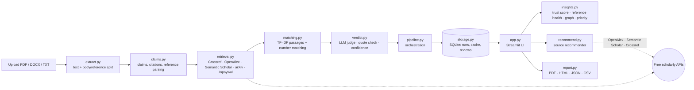

# 🔎 CiteVerify – Scientific Claim and Citation Verification System

   

> **Tagline:** *A reference that exists is not a reference that proves the claim.*
> CiteVerify reads an academic document, finds every claim and citation, retrieves the **original cited papers**, checks whether each source **really supports** the statement, and produces an **evidence-backed, human-reviewable report**. When a source does not hold up, it also **recommends better sources to read**.

<!-- TODO (owner): add Live demo link and Demo video link here -->

---

## At a glance (summary for reviewers and automated screening)

| Item | Value |
|---|---|
| Project | CiteVerify – Scientific Claim and Citation Verification System |
| Event / problem | InnovEdge 2026 – Problem Statement 03: Scientific Claim and Citation Verification |
| Domain | Research technology, academic integrity |
| Input | Research paper or report (PDF, DOCX, TXT) |
| Output | Claim-by-claim verification report (PDF, HTML, JSON, CSV) with verdict, explanation, evidence quote, source link, confidence |
| Core question answered | *Does the original cited paper actually support this specific claim?* |
| Verdict labels | Supported · Partially Supported · Unsupported · Contradictory · Needs Review |
| Human-in-the-loop | Accept / override / comment on every finding, with timestamped audit trail |
| Cost | Free: Groq or Gemini or local Ollama for the LLM; Crossref, OpenAlex, Semantic Scholar, arXiv, Unpaywall for retrieval; works offline in rule-based mode |
| Stack | Python, Streamlit, scikit-learn, PyMuPDF, python-docx, SQLite, ReportLab, pytest |
| Run | `streamlit run app.py` |
| Unique additions (v1.1) | Source Recommender, Academic Trust Score, Reference Health funnel, Claim→Source→Evidence graph, Review Priority queue |

**Status legend used in this README:** ✅ implemented and covered by tests · 🧪 experimental / depends on live third-party APIs · 🗓️ planned (not implemented).

---

## 1. Problem overview

Students and researchers cite papers to support statements in reports and assignments. A reference can be **incorrect, outdated, retracted, unrelated, or fabricated** – and even a genuine paper may **not prove the claim** (for example, the text says *"improved scores by 30%"* but the paper reports a small pilot with no such figure). Checking every reference by hand is slow, so unsupported statements slip through.

**Why citation-existence checkers are not enough.** Looking up a DOI answers only "does this paper exist?". CiteVerify separates three different questions and never conflates them:

| Question | Meaning | Where it is shown |
|---|---|---|
| **Exists** | The reference resolves to a real publication (Crossref / OpenAlex / Semantic Scholar / arXiv) | Insights → Reference health |
| **Matched** | The citation in the text maps to the correct reference entry | Insights → Reference health |
| **Supports** | The *retrieved source text* actually backs up the specific claim, numbers and scope | Claim-by-claim verdict + evidence quote |

## 2. Proposed solution and objectives

1. Extract the statements, numbers and conditions that need evidence.
2. Detect citations (`[1]`, `[1-3]`, `(Author, Year)`) and map each claim to its reference.
3. Retrieve the original paper (title, author, DOI, arXiv id) and, when open access, its full text.
4. Compare claim and source passages (findings, numbers, scope, limitations).
5. Classify each claim and explain *why*, with a verbatim, verified evidence quote.
6. Detect misleading references (missing, unmatched, not found, retracted, unrelated, numeric mismatch).
7. Keep a human in control and produce a transparent report.
8. **Go one step further:** recommend which published sources a writer could use instead (v1.1).

## 3. Alignment with the official problem statement

| # | Official requirement | CiteVerify implementation | Code | Where to see it in the app |
|---|---|---|---|---|
| 1 | Document and claim extraction | PDF/DOCX/TXT parsing; sentence-level claim extraction using citations **and** claim cues (percentages, "studies show", "significantly") | `src/extract.py`, `src/claims.py` ✅ | Upload → *Extracted text preview*, Claim-by-claim |
| 2 | Citation detection and mapping | Detects `[1]`, `[2-4]`, `(A, 2019; B, 2020)`; parses the reference list; maps numeric-id and author-year citations; flags unmatched ones | `src/claims.py` (`map_citation`) ✅ | References tab, Insights → Reference health |
| 3 | Original paper retrieval | DOI → Crossref / OpenAlex / Semantic Scholar; arXiv id; title-search fallback with similarity threshold; Unpaywall for open-access PDFs | `src/retrieval.py` ✅ | Claim detail → *Source trace* |
| 4 | Evidence comparison | Top-k source passages (TF-IDF, optional embeddings, number matching) judged against the claim by a free LLM; checks numbers, sample size, causality, generalisation | `src/matching.py`, `src/verdict.py` ✅ | Claim detail → *Evidence* |
| 5 | Claim status classification | Five official labels (see §4) from internal statuses | `STATUS` in `src/verdict.py`, `src/insights.py` (`official_label`) ✅ | Overview chart, Insights → official-label chart |
| 6 | Evidence and source traceability | Highlighted passage, section/page where available, source link, providers used, **quote verified verbatim** in the retrieved text | `src/verdict.py`, `app.py` ✅ | Claim detail → *Evidence*, *Source trace* |
| 7 | Misleading reference detection | Reference not found, bad DOI, citation not in list, **retracted** paper, unrelated source, numeric mismatch, scope overreach, duplicates, unmatched references | `verify_claim()` in `src/verdict.py`, `src/insights.py` ✅ | Flags on each claim; Insights → Reference health |
| 8 | Verification report | Claim-by-claim report with verdicts, explanations, confidence, evidence and links; PDF / HTML / JSON / CSV | `src/report.py` ✅ | Export tab |

## 4. Verdict definitions

| Official label | Meaning | Typical internal statuses |
|---|---|---|
| **Supported** | The retrieved original source directly supports the claim within its stated research context | Supported |
| **Partially Supported** | The source supports some aspects, or the claim overstates the findings | Partly supported |
| **Unsupported** | The source does not provide enough evidence to justify the claim | Unsupported |
| **Contradictory** | The source provides evidence that conflicts with the claim | Contradictory |
| **Needs Review** | Evidence, matching or retrieval is insufficient for a reliable automated decision | Cannot verify, Missing citation, Bad reference, Possibly outdated |

The internal statuses are richer than the five official labels; `official_label()` in `src/insights.py` maps them, and the Insights tab shows the distribution in the five official labels. Every finding also carries a confidence score and a `needs_review` flag.

## 5. Key features

### Core verification engine ✅
* **Quote verification** – the evidence quote returned by the LLM must exist in the retrieved source text; otherwise it is flagged `quote_unverified` and confidence is capped. This blocks hallucinated evidence.
* **Numeric claim checker** – catches "30%" in the claim versus what the paper actually reports.
* **Retraction check** – via Crossref and OpenAlex metadata.
* **Honest "Cannot verify"** – when only metadata/abstract is available (paywalled papers) the tool says so and lowers confidence.
* **Transparent confidence** – weighted breakdown of retrieval similarity, source access, number agreement, model certainty, quote verified and reference match. Confidence expresses evidence strength and uncertainty, not a guarantee.
* **Human review** – accept / override / comment per finding, stored with timestamps in SQLite; the original AI verdict is preserved.
* **Caching** of API/LLM calls for reproducibility and speed.
* **Offline rule-based mode** when no LLM is configured (confidence capped at 0.5).

### Unique innovations added in v1.1

| Feature | What it does | Code | Status |
|---|---|---|---|
| 💡 **Source Recommender** | For any claim, searches OpenAlex, Semantic Scholar and Crossref, merges duplicates, and ranks candidate papers to read with a transparent score and plain-language reasons. Retracted papers go on a **"do not cite"** list. Never marks a candidate as verified. | `src/recommend.py` | ✅ logic unit-tested with mocked APIs · 🧪 live results depend on provider availability |
| 🛡️ **Academic Trust Score** | Document-level 0–100 score from five visible components (claim support, reference resolution, evidence integrity, coverage, penalties) with its formula shown. Labelled as a CiteVerify assessment, not an official quality measure. | `src/insights.py` | ✅ |
| 🧬 **Reference Health funnel** | Per-reference *exists → matched → supports* funnel, plus retracted, older, duplicate and unmatched flags. A real paper is never treated as proof. | `src/insights.py` | ✅ |
| 🕸️ **Claim → Source → Evidence map** | Graph of each claim, its source paper and evidence passage, coloured by verdict. | `src/insights.py`, `src/ui_extras.py` | ✅ |
| 🚦 **Review Priority queue** | Ranks claims by how urgently a human should check them (verdict severity, low confidence, unmatched numbers, unverified quotes). | `src/insights.py` | ✅ |

### How the Source Recommender ranks papers
Each candidate gets a 0–100 score; the components are shown for every result.

| Component | Weight | Signal |
|---|---|---|
| Relevance | 0.45 | TF-IDF cosine similarity between the claim and the paper's title + abstract |
| Number match | 0.10 | Claim numbers that also appear in the abstract (only applied if the claim has numbers; weights are renormalised otherwise) |
| Accessibility | 0.15 | Open-access full text > abstract only > metadata only (so the evidence can really be checked) |
| Authority | 0.15 | Log-scaled citation count (influence, not correctness) |
| Recency | 0.10 | Gentle decay with a floor – age alone never disqualifies a paper; older papers are flagged, not rejected |
| Integrity | 0.05 | Known not retracted > unknown. Retracted papers are excluded and listed separately |

Safeguards: no result is invented when providers fail (the failure is shown per provider); a paper already cited for the claim is badged `already_cited`; every candidate carries `support_verified = false` until the person reads it.

## 6. System architecture



### Verification workflow
Upload → text extraction → claim identification → citation detection → reference mapping → DOI/metadata validation → original-paper retrieval → evidence passage ranking → LLM claim-vs-evidence judgment → quote and numeric checks → confidence breakdown → verdict → human review → report. The progress bar reports the real stage being executed.

## 7. Methodology

* **Claim extraction** – sentence-level; a sentence becomes a claim if it carries a citation or a claim cue (percentages, quantities, "studies show", "significantly", causal wording). Uncited claims are kept so that *missing citations* can be reported.
* **Citation mapping** – numeric ids and ranges are resolved against the parsed reference list; author-year citations are matched on author and year. Unresolvable citations are flagged, never silently dropped.
* **Retrieval** – DOI first, arXiv id second, title search with a similarity threshold as fallback. Full text is used only when an open-access copy exists; otherwise results are labelled abstract-only/metadata-only.
* **Evidence selection** – source text is split into passages (with section/page where available) and ranked by TF-IDF (optionally sentence embeddings) plus number overlap.
* **Judgment** – a free LLM receives the claim and the top passages and must return a verdict and a *verbatim* quote. The quote is then checked against the source text. Without an LLM, a rule-based comparer runs with confidence capped at 0.5.
* **Confidence** – a weighted breakdown (retrieval similarity, source access, number agreement, model certainty, quote verified, reference match) shown in the UI.
* **Trust Score** – weighted mean of: claim support 40 %, reference resolution 20 %, evidence integrity 15 %, coverage 15 %, penalties 10 % (contradictions, retracted sources, missing/bad references). Components without data are skipped and weights renormalised. See `trust_score()` in `src/insights.py`.

## 8. Evidence traceability

For each claim the app shows: the claim and citation → the matched reference → the retrieved source (title, year, DOI/URL, access level, providers used) → the evidence passage with section, the **verbatim quote highlighted** and a ✅/❌ marker for whether the quote was found in the source. Direct quotations come only from retrieved source text; explanations are model-written and labelled as such.

## 9. Dashboard (Streamlit tabs)

| Tab | Purpose |
|---|---|
| 📊 Overview | KPI cards (documents, claims, supported, unsupported/contradictory, needs review, Trust Score), verdict donut in the five official labels, confidence distribution, citation-integrity funnel - all computed from the real run |
| 🧾 Claim-by-claim | Filter by status; full evidence, source trace, flags, numeric check, confidence breakdown, human review |
| ⚠️ Needs human review | Queue of pending findings |
| 🛡️ Insights (v1.1) | Trust Score, five-label distribution, reference health funnel, review priority, claim graph |
| 💡 Source recommender (v1.1) | Ranked papers to read for any claim or custom statement, CSV export |
| 📚 References | Per-reference resolution, match score, year, access, retraction, DOI, providers |
| 🕘 Review history | Timestamped human decisions |
| ⬇️ Export | PDF, HTML, JSON (full data + audit trail), CSV |

## 10. Technology stack

Python · Streamlit · scikit-learn (TF-IDF) · PyMuPDF · python-docx · pandas · SQLite · ReportLab · requests · pytest · free LLM APIs (Groq / Google Gemini / local Ollama) · Crossref · OpenAlex · Semantic Scholar · arXiv · Unpaywall.

## 11. Project structure

```
CiteVerify/
├── app.py                  # Streamlit UI and tab layout
├── src/
│   ├── config.py           # settings from .env
│   ├── extract.py          # PDF/DOCX/TXT reading
│   ├── claims.py           # claims, citations, reference parsing
│   ├── retrieval.py        # Crossref/OpenAlex/Semantic Scholar/arXiv/Unpaywall
│   ├── matching.py         # evidence passage ranking
│   ├── verdict.py          # LLM judge, quote check, confidence, STATUS table
│   ├── pipeline.py         # end-to-end orchestration
│   ├── report.py           # PDF/HTML/JSON/CSV export
│   ├── storage.py          # SQLite cache, runs, review history
│   ├── recommend.py        # (v1.1) source recommender
│   ├── insights.py         # (v1.1) trust score, reference health, graph, priority
│   ├── ui_extras.py        # (v1.1) Streamlit renderers for the new tabs
│   └── theme.py            # (v1.1) premium dashboard theme: CSS, hero, KPI cards, charts
├── .streamlit/config.toml  # navy / gold / teal Streamlit theme
├── tests/                  # unit + end-to-end tests (network mocked)
│   ├── test_recommend.py   # (v1.1)
│   ├── test_insights.py    # (v1.1)
│   ├── test_ui_extras.py   # (v1.1)
│   └── test_theme.py       # (v1.1)
├── scripts/benchmark.py    # accuracy on the planted-error sample document
├── data/sample/            # sample_paper.txt with planted problems
├── docs/                   # benchmark_results.md
├── requirements.txt  .env.example  .gitignore  pytest.ini  LICENSE
```

## 12. Installation, configuration and running

```bash
git clone https://github.com/maheshgowdanmg-del/CiteVerify.git
cd CiteVerify
python -m venv .venv
# Windows: .venv\Scripts\activate      Mac/Linux: source .venv/bin/activate
pip install -r requirements.txt
cp .env.example .env        # Windows: copy .env.example .env  -> then edit .env
streamlit run app.py
```
Open http://localhost:8501, click **Use sample document**, then **Verify claims**.

> Always start the app with `streamlit run app.py` (or `python -m streamlit run app.py`). Running `app.py` as a plain Python script (for example the IDE's default Run button) will not work.

### API keys (`.env`) – everything is free
| Variable | Required? | Where to get it |
|---|---|---|
| `LLM_PROVIDER` + `LLM_API_KEY` | Recommended | **Groq** console.groq.com, **Gemini** aistudio.google.com/apikey, or **Ollama** (local, no key). Use `none` for offline rule-based mode |
| `CONTACT_EMAIL` | Yes | Your real email (polite-pool access for Crossref/OpenAlex/Unpaywall and the source recommender) |
| `SEMANTIC_SCHOLAR_API_KEY` | Optional | semanticscholar.org/product/api (raises rate limits) |
| `OUTDATED_YEARS` | Optional | Age above which a source is flagged as older (default 10). Age alone never decides a verdict |
| `USE_EMBEDDINGS` | Optional | `true` enables sentence-transformers (large download) |

Secrets live only in `.env`, which is git-ignored. Never put real keys in `.env.example`.

## 13. Evaluator walkthrough (about 3 minutes)

1. `streamlit run app.py` → click **Use sample document** → **Verify claims**.
2. **Overview** – verdict distribution and counts of what needs review.
3. **Claim-by-claim** – open the inflated-number claim: see the numeric check, the highlighted evidence passage and the quote-verified marker.
4. **Insights** – Trust Score with its formula, the exists → matched → supports funnel, the retracted reference, and the claim → source → evidence graph.
5. **Source recommender** – pick a weak claim → **Find sources** → ranked papers with reasons, flags and a "do not cite" list.
6. **Human review** – override a verdict and add a comment; see it in **Review history**.
7. **Export** – download the PDF/HTML/JSON/CSV report.

## 14. Sample input and expected behaviour

`data/sample/sample_paper.txt` contains deliberately planted problems. The table lists what each is designed to trigger (the measured benchmark is produced by `python -m scripts.benchmark` into `docs/benchmark_results.md`).

| Planted problem | Expected CiteVerify behaviour |
|---|---|
| Correct claim with a matching source | Supported, quote verified |
| Inflated number (45.0 vs 28.4 BLEU) | Numeric mismatch flagged, not Supported |
| Over-generalised claim | Partially Supported / scope flag |
| Retracted paper | Retraction flag, penalised in the Trust Score |
| Fabricated reference | Reference not found / bad reference, Needs Review |
| Uncited claim | Missing citation |

## 15. Testing

```bash
pytest                         # unit + end-to-end tests (network mocked)
python -m scripts.benchmark    # accuracy on the planted-error sample document
```
The v1.1 modules are covered offline: provider failures, merging, retraction exclusion and ranking in the recommender; trust score, reference funnel, citation-range parsing, priority ordering and graph escaping in insights; and smoke tests of the Streamlit renderers with a fake Streamlit object.

## 16. Limitations (stated honestly)

* Results are **decision support, not final academic judgments**; every finding is reviewable and overridable and all human decisions are logged.
* Full-text evidence exists only for open-access papers; otherwise the tool says so and lowers confidence.
* Reference parsing uses heuristics and may fail on unusual citation styles. The reference-to-claim mapping in the Insights tab is best-effort for author-year citations.
* LLM verdicts can be wrong; quote verification and the numeric check reduce, but do not remove, this risk.
* Retraction detection depends on Crossref/OpenAlex metadata.
* The Source Recommender ranks by relevance and metadata; it cannot confirm that a candidate supports a claim, and free APIs may rate-limit or be offline.
* The Trust Score is a transparent heuristic, not an accepted academic metric.
* Scanned PDFs without a text layer are not supported (no OCR).

## 17. Future scope 🗓️

OCR for scanned PDFs · natural-language-inference model for claim–evidence entailment · publisher full-text APIs · citation-context analysis over whole reference lists · multilingual documents · browser extension · one-click "replace citation with recommended source" in the exported report.

## 18. Academic integrity and responsible AI

CiteVerify never fabricates quotations, page numbers or sources; it reports limitations instead of guessing; it preserves the original AI verdict next to any human override; and it labels recommendations and scores as aids to judgment. It should support, not replace, a reviewer's reading of the source.

## 19. Contributors and license

Contributors: GitHub [@maheshgowdanmg-del](https://github.com/maheshgowdanmg-del) and the CiteVerify team. License: MIT (see `LICENSE`).
